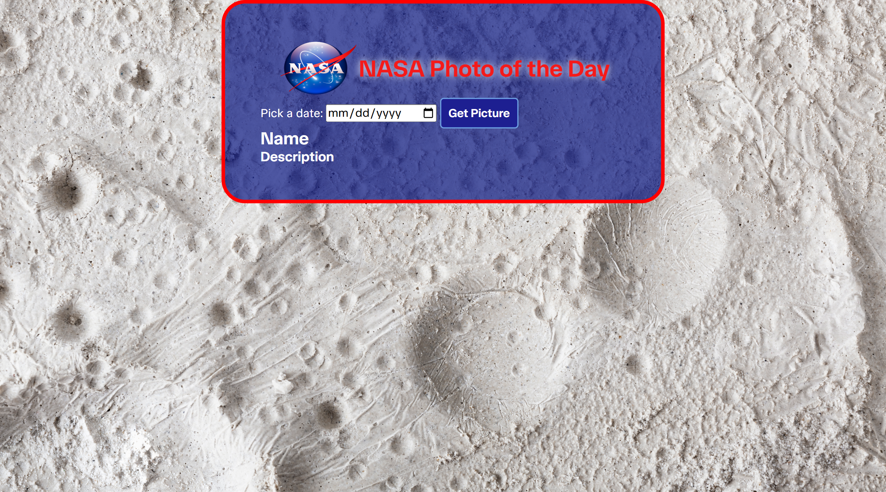

# 🚀 Project: Simple NASA API

### Goal: Enable your user to enter a date and return the picture/video of the day from NASA's API

## Project Description

Use this web app to see the astronomy photo or video of the day (APOD). It uses science.nasa.gov/wp-json/wp/v2/apod API to retrieve the photo or video of the day from whatever date you choose. 

The application displays the Photo/Video title, the image/video (with the ability to play the video), and a description/explanation. 

Let your imagination run wild after discovering the wonders of our would and the space and stars around us. Click the hyperlinks in the description for your APOD selection to learn more. 

## Tech Stack

- **HTML** 
- **CSS**
- **JavaScript**

## How to Run or View It

1. Clone or download the repository.
2. Open `index.html` in a browser or serve the project using a local development server.
3. Select any date (today or in the past) - future dates not supported
4. Click **Get Picture** to retrieve image or video of the day 

The application requires an internet connection to access its external APIs. API availability and credential requirements may affect the results.

No API Key required

## Screenshots and Demo

### Application Interface

.png)

The interface displays the Photo/Video title, the image/video (with the ability to play the video), and a description/explanation. 